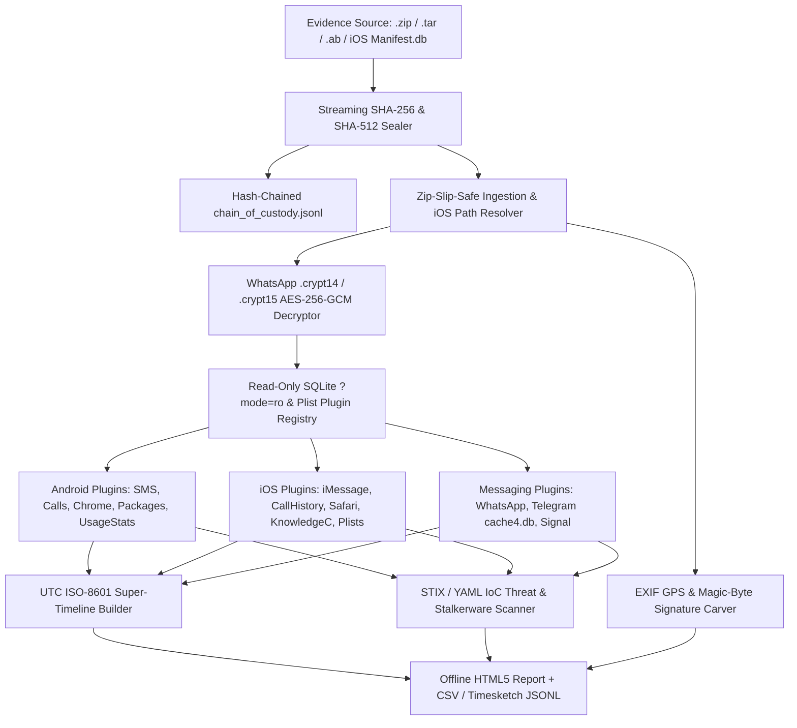

<div align="center">

# OmniForensix-Mobile

**Open-Source Cross-Platform Mobile Digital Forensics & Post-Acquisition Artifact Analysis Toolkit (Android & iOS)**

[](https://github.com/MrKhan025/OmniForensix-Mobile/actions/workflows/ci.yml)
[](https://github.com/MrKhan025/OmniForensix-Mobile/actions/workflows/codeql.yml)
[](https://www.python.org/)
[](https://opensource.org/licenses/Apache-2.0)
[](https://github.com/astral-sh/ruff)
[](https://mypy-lang.org/)
[](#supported-forensic-artifacts)
[](#forensic-soundness--chain-of-custody)

</div>

`OmniForensix-Mobile` is a modular, production-ready digital forensics and incident response (DFIR) framework designed for analyzing **authorized, post-acquisition mobile forensic images, logical backups, and file system extractions** from **Android** and **iOS** devices.

> **Legal & Ethical Notice**: `OmniForensix-Mobile` operates strictly on pre-acquired backups and authorized forensic extractions (similar in scope to ALEAPP, iLEAPP, and the Mobile Verification Toolkit). It intentionally excludes lockscreen bypasses, bootloader exploits, rooting/jailbreaking payloads, or unauthorized live-extraction utilities.

## Key Capabilities

| Capability | Technical Implementation |
| :--- | :--- |
| **Evidence Sealing & Chain of Custody** | Streams `.zip`, `.tar`, Android `.ab`, and iOS backup folders through dual **SHA-256** and **SHA-512** hashers and logs every action to a cryptographically hash-chained `chain_of_custody.jsonl` ledger. |
| **WhatsApp `.crypt14` / `.crypt15` Decryption** | Decrypts Android WhatsApp `msgstore.db.crypt14` and `msgstore.db.crypt15` databases via **AES-256-GCM** + `zlib` when an authorized 158-byte `key` file or 64-character hex key is present. |
| **14 Native & Third-Party Artifact Plugins** | Extracts SMS/MMS, iMessage, Call Logs, Chrome, Safari, Installed Packages (`packages.xml`), UsageStats, CoreDuet (`knowledgeC.db`), Wi-Fi `.plist` files, **WhatsApp** (Android & iOS), **Telegram**, and **Signal**. |
| **Super-Timeline Engine (UTC ISO-8601)** | Normalizes Unix Epoch (`s`/`ms`/`us`/`ns`), Cocoa/Mac Absolute Time (`2001-01-01`), and WebKit/Chrome (`1601-01-01`) timestamps into chronological CSV and **Timesketch JSONL** timelines. |
| **Stalkerware & Threat IoC Scanner** | Cross-references extracted package names, domains, IPv4/IPv6 addresses, SMS/WhatsApp/Telegram links, and file SHA-256 digests against YAML/STIX watchlists. |
| **EXIF, Magic-Byte & SQLite WAL Auditor** | Extracts GPS coordinates from JPEG/PNG EXIF tags, flags extension spoofing via magic-byte header checks, and inspects SQLite `-wal` journals and deleted freelist pages. |
| **Offline HTML5 Report & FastAPI Viewer** | Generates dark-mode, self-contained HTML5 investigative reports with interactive search filters plus an optional local read-only FastAPI server (`omniforensix serve`). |

## Architecture Pipeline



## Supported Forensic Artifacts

| Platform | Plugin Name | Target Files / Globs | Extracted Forensic Data |
| :--- | :--- | :--- | :--- |
| **Android** | `android_sms_mms` | `*mmssms.db` | SMS inbox/sent messages, addresses, thread IDs, read status, service center |
| **Android** | `android_calls_contacts` | `*contacts2.db`, `*calllog.db` | Incoming/outgoing/missed calls, duration, cached contact names, geocoded location |
| **Android** | `android_chrome_history` | `*History`, `*chrome_history.db` | Visited URLs, page titles, visit counts, WebKit microsecond timestamps |
| **Android** | `android_packages_xml` | `*packages.xml` | Installed package IDs, code paths, installer source, granted permissions, hex install times |
| **Android** | `android_usage_stats` | `*usagestats*.xml`, `*usage-history.xml` | Last active timestamps and cumulative foreground execution time |
| **Android** | `android_whatsapp` | `*msgstore.db`, `*wa.db` | Modern & legacy WhatsApp chat messages, JIDs, GPS pins, media MIME types, and WhatsApp contacts |
| **iOS** | `ios_imessage_sms` | `*sms.db` | iMessage & SMS messages, handle IDs, GUIDs, service type, Cocoa nanosecond/second timestamps |
| **iOS** | `ios_call_history` | `*CallHistory.storedata` | Telephony & FaceTime call records (`ZCALLRECORD`), durations, answered flags |
| **iOS** | `ios_safari_history` | `*History.db`, `*safari_history.db` | Safari browsing history items and visits in Cocoa/Mac Absolute Time |
| **iOS** | `ios_knowledgec` | `*knowledgeC.db` | CoreDuet (`ZOBJECT`) app foreground focus intervals and device state telemetry |
| **iOS** | `ios_plist_configs` | `*com.apple.wifi.plist`, `*Info.plist` | Known Wi-Fi SSIDs, BSSIDs, last joined dates, and iOS system build metadata |
| **iOS** | `ios_whatsapp` | `*ChatStorage.sqlite` | iOS WhatsApp messages (`ZWAMESSAGE`) joined with chat sessions (`ZWACHATSESSION`) |
| **Cross-OS** | `telegram_cache_parser` | `*cache4.db`, `*tgdata.db` | Telegram `messages_v2`/`messages` and `users` records with binary TL string extraction |
| **Cross-OS** | `signal_backup_parser` | `*signal.db`, `*signal_backup.db` | Decrypted Signal messages, recipient profiles (`e164`), and disappearing message timers (`expires_in`) |

## Installation

```bash
git clone https://github.com/MrKhan025/OmniForensix-Mobile.git
cd OmniForensix-Mobile
python3 -m venv .venv
source .venv/bin/activate
pip install -e ".[dev]"
```

## CLI Usage Reference

```bash
# Run the complete end-to-end forensic pipeline (ingest -> decrypt -> parse -> ioc-scan -> timeline -> report)
omniforensix analyze /path/to/extraction --case-dir ./case_001 --case-id CASE-2026-01 --examiner "MrKhan025"

# Decrypt an Android WhatsApp .db.crypt14 or .db.crypt15 database using a 158-byte key file or 64-digit hex key
omniforensix decrypt ./msgstore.db.crypt14 --key ./key --output ./msgstore.db

# Run individual pipeline stages modularly
omniforensix ingest /path/to/backup.ab --case-dir ./case_001 --case-id CASE-001
omniforensix parse --case-dir ./case_001
omniforensix ioc-scan --case-dir ./case_001 --ioc-file ./watchlists/default_iocs.yaml
omniforensix timeline --case-dir ./case_001
omniforensix report --case-dir ./case_001

# Launch the local read-only FastAPI web dashboard on http://127.0.0.1:8080
omniforensix serve --case-dir ./case_001 --port 8080
```

## Running Linters & Unit Tests

```bash
ruff check src/ tests/
mypy src/omniforensix
pytest --cov=omniforensix --cov-report=term-missing
```
