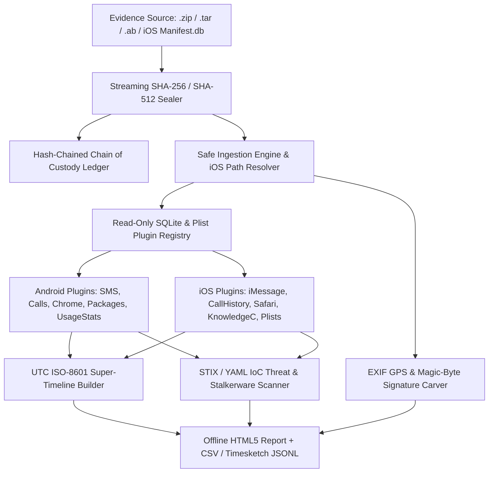

# OmniForensix-Mobile

**Open-Source Cross-Platform Mobile Digital Forensics & Artifact Analysis Toolkit (Android & iOS)**

`OmniForensix-Mobile` is a modular, forensically sound Python framework for analyzing **authorized, post-acquisition mobile forensic extractions, logical backups, and file system dumps** from Android and iOS devices.

> **Legal & Ethical Scope**: This toolkit operates strictly on pre-acquired backups and authorized forensic extractions. It contains zero lockscreen bypasses, bootloader exploits, or unauthorized extraction payloads.

## Architecture Overview



## Quick Start

```bash
pip install -e ".[dev]"
omniforensix /path/to/backup --case-dir ./case_001 --case-id CASE-2026-01 --examiner "A. Investigator"
pytest
```
